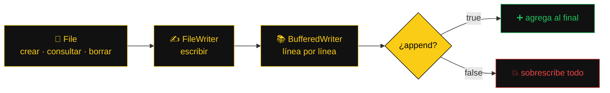

<a name="inicio"></a>

<div align="center">


<p>


</p>
<p>


</p>


**La noche es oscura. Los archivos deben quedar guardados.**

[🦇 Expediente](#-el-expediente) ·
[🦸 Batfamilia](#-la-batfamilia) ·
[🗺️ Mapa](#️-mapa-de-gotham) ·
[🧰 Batcinturón](#-batcinturón--clases-y-métodos) ·
[⚙️ Ejecución](#️-activando-la-batcomputadora) ·
[🃏 Villanos](#-galería-de-villanos)

</div>


## 🦇 El expediente

Hasta la APE 4 todo lo que hacían nuestros programas desaparecía al cerrarlos. En la **APE 5** aprendimos a dejar evidencia en disco con el paquete `java.io`: **crear**, **escribir**, **agregar** y **eliminar** archivos de texto.



## 🦸 La Batfamilia

| N.º | BatIntegrante | BatOperación | Expedientes |
| :---: | :--- | :--- | :---: |
| 🔍 **1** | **Paredes Acosta Dereck Shair** | Detective del Código Oscuro · Analista | 04 · 09 |
| 🏗️ **2** | **Ashanga Yumbo Brishy Anahy** | Arquitecta de la Baticueva · Diseño | 02 · 07 |
| ⚔️ **3** | **Calderón Carvajal Fher Dorian** | Caballero del Backend · Programación | 01 · 05 |
| 🛡️ **4** | **Casillas Ochoa Antony Sebastián** | Guardián Nocturno del Testing · Pruebas | 03 · 08 |
| 📜 **5** | **Sánchez Bastidas Karina Paola** | Oráculo del Conocimiento · Documentación | 06 · 10 |

<div align="center">

</div>

> [!IMPORTANT]
> **Regla de la Baticueva:** ningún caso se cierra solo porque «en mi computadora sí funciona».


## 🗺️ Mapa de Gotham

<table>
<tr>
<td valign="top" width="33%">

**🌃 Distrito 1 · Crear, escribir y eliminar**
1. 📄 Crear un fichero
2. ✍️ Escribir en un fichero
3. 🗑️ Eliminar un fichero

</td>
<td valign="top" width="33%">

**🌉 Distrito 2 · Archivos y flujos**

4. 🔎 Metadatos con File
5. 📚 BufferedWriter
6. ➕ Append vs sobrescribir
7. ♻️ Borrado seguro

</td>
<td valign="top" width="33%">

**🏙️ Distrito 3 · Clase 2**

8. 🎓 Registro de estudiantes
9. 🛒 Registro de productos
10. 💵 Registro de ventas

</td>
</tr>
</table>

> [!NOTE]
> Algunos expedientes dependen de otros: el **06** usa el `materias.txt` del **05**, el **02** necesita que `estudiantes.txt` exista y el **03** lo elimina.

<div align="center">

</div>

## 🌃 Distrito 1 · Crear, escribir y eliminar

### 📄 Expediente 01 · Crear un fichero

| 🔎 Pista | 📂 Detalle |
| :--- | :--- |
| **Archivo** | [`CrearFichero.java`](./Parte%201%20-%20Crear%20escribir%20y%20eliminar/Ejercicio%2001%20-%20Crear%20un%20fichero/CrearFichero.java) |
| **Agente** | Dorian |
| **Gadgets** | `File`, `createNewFile()`, `getName()`, `try-catch` |
| **Misión** | Crea `curso.txt`; si ya existe, avisa. |

<details>
<summary><b>🖥️ Ver salida en la Batcomputadora</b></summary>

```text
El archivo se creo correctamente
Nombre del archivo: curso.txt

--- segunda ejecución ---
El archivo ya existe
Nombre del archivo: curso.txt
```

</details>

---

### ✍️ Expediente 02 · Escribir en un fichero

| 🔎 Pista | 📂 Detalle |
| :--- | :--- |
| **Archivo** | [`EscribirFichero.java`](./Parte%201%20-%20Crear%20escribir%20y%20eliminar/Ejercicio%2002%20-%20Escribir%20en%20un%20fichero/EscribirFichero.java) |
| **Agente** | Brishy |
| **Gadgets** | `Scanner`, `FileWriter(..., true)`, `write()`, `close()` |
| **Misión** | Agrega un mensaje al final de `estudiantes.txt` (debe existir). |

<details>
<summary><b>🖥️ Ver salida en la Batcomputadora</b></summary>

```text
Escriba un mensaje: Carla Villacis - Software 1B
La informacion se guardo correctamente
```

</details>

<details>
<summary><b>📁 Ver cómo quedó <code>estudiantes.txt</code></b></summary>

```text
Ana Torres - Software 1B
Luis Mena - Software 1B
Carla Villacis - Software 1B
```

</details>

---

### 🗑️ Expediente 03 · Eliminar un fichero

| 🔎 Pista | 📂 Detalle |
| :--- | :--- |
| **Archivo** | [`EliminarFichero.java`](./Parte%201%20-%20Crear%20escribir%20y%20eliminar/Ejercicio%2003%20-%20Eliminar%20un%20fichero/EliminarFichero.java) |
| **Agente** | Casillas |
| **Gadgets** | `File`, `delete()`, `if-else` |
| **Misión** | Elimina `estudiantes.txt` y avisa si pudo o no. |

<details>
<summary><b>🖥️ Ver salida en la Batcomputadora</b></summary>

```text
El archivo estudiantes.txt fue eliminado

--- segunda ejecución ---
No se pudo eliminar estudiantes.txt, revise que exista y que no este abierto
```

</details>


<div align="center">

</div>

## 🌉 Distrito 2 · Archivos y flujos de datos

### 🔎 Expediente 04 · Metadatos con File

| 🔎 Pista | 📂 Detalle |
| :--- | :--- |
| **Archivo** | [`MetadatosArchivo.java`](./Parte%202%20-%20Archivos%20y%20flujos%20de%20datos/Ejercicio%2004%20-%20Metadatos%20con%20File/MetadatosArchivo.java) |
| **Agente** | Dereck |
| **Gadgets** | `exists()`, `createNewFile()`, `getName()`, `getPath()` |
| **Misión** | Revisa `datos/prueba.txt`, lo crea si falta y muestra nombre y ruta. |

<details>
<summary><b>🖥️ Ver salida en la Batcomputadora</b></summary>

```text
El archivo no existia, se creo correctamente
Nombre: prueba.txt
Ruta: datos/prueba.txt

--- segunda ejecución ---
El archivo ya existe en el disco
Nombre: prueba.txt
Ruta: datos/prueba.txt
```

</details>

---

### 📚 Expediente 05 · Escritura con BufferedWriter

| 🔎 Pista | 📂 Detalle |
| :--- | :--- |
| **Archivo** | [`EscribirMaterias.java`](./Parte%202%20-%20Archivos%20y%20flujos%20de%20datos/Ejercicio%2005%20-%20Escritura%20con%20BufferedWriter/EscribirMaterias.java) |
| **Agente** | Dorian |
| **Gadgets** | `BufferedWriter`, `FileWriter`, `newLine()` |
| **Misión** | Guarda 5 materias en `materias.txt`, una por línea. |

<details>
<summary><b>🖥️ Ver salida en la Batcomputadora</b></summary>

```text
Se guardaron 5 materias en materias.txt
```

</details>

<details>
<summary><b>📁 Ver cómo quedó <code>materias.txt</code></b></summary>

```text
Algoritmos y Logica de Programacion
Calculo Diferencial
Fisica
Metodologia de la Investigacion
Algebra Lineal
```

</details>

---

### ➕ Expediente 06 · Append vs sobrescribir

| 🔎 Pista | 📂 Detalle |
| :--- | :--- |
| **Archivo** | [`AgregarMaterias.java`](./Parte%202%20-%20Archivos%20y%20flujos%20de%20datos/Ejercicio%2006%20-%20Append%20vs%20sobrescribir/AgregarMaterias.java) |
| **Agente** | Paola |
| **Gadgets** | `FileWriter(..., true)`, `newLine()` |
| **Misión** | Agrega 2 materias sin borrar las 5 anteriores. Correr antes el 05. |

<details>
<summary><b>🖥️ Ver salida en la Batcomputadora</b></summary>

```text
Se agregaron 2 materias al final de materias.txt
```

</details>

<details>
<summary><b>📁 Ver cómo quedó <code>materias.txt</code></b></summary>

```text
Algoritmos y Logica de Programacion
Calculo Diferencial
Fisica
Metodologia de la Investigacion
Algebra Lineal
Programacion Orientada a Objetos
Estructura de Datos
```

</details>

---

### ♻️ Expediente 07 · Ciclo de vida y borrado seguro

| 🔎 Pista | 📂 Detalle |
| :--- | :--- |
| **Archivo** | [`CicloVidaArchivo.java`](./Parte%202%20-%20Archivos%20y%20flujos%20de%20datos/Ejercicio%2007%20-%20Ciclo%20de%20vida%20y%20borrado%20seguro/CicloVidaArchivo.java) |
| **Agente** | Brishy |
| **Gadgets** | `exists()`, `createNewFile()`, `boolean confirmarBorrado`, `delete()` |
| **Misión** | Crea `datos/temporal.txt` y lo borra solo si se confirma. |

<details>
<summary><b>🖥️ Ver salida en la Batcomputadora</b></summary>

```text
Archivo creado: datos/temporal.txt
Resultado de la eliminacion: true
```

</details>


<div align="center">

</div>

## 🏙️ Distrito 3 · Ejercicios de clase 2

### 🎓 Expediente 08 · Registro de estudiantes

| 🔎 Pista | 📂 Detalle |
| :--- | :--- |
| **Archivo** | [`RegistroEstudiantes.java`](./Parte%203%20-%20Ejercicios%20de%20clase%202/Ejercicio%2008%20-%20Registro%20de%20estudiantes/RegistroEstudiantes.java) |
| **Agente** | Casillas |
| **Gadgets** | `Scanner`, `BufferedWriter`, `for` |
| **Misión** | Guarda 3 estudiantes, dos líneas cada uno. |

<details>
<summary><b>🖥️ Ver salida en la Batcomputadora</b></summary>

```text
Estudiante 1
Nombre: Valeria Castro
Calificacion: 9.5
Estudiante 2
Nombre: Javier Yanez
Calificacion: 6.75
Estudiante 3
Nombre: Lucia Haro
Calificacion: 8
Datos guardados en estudiantes.txt
```

</details>

<details>
<summary><b>📁 Ver cómo quedó <code>estudiantes.txt</code></b></summary>

```text
Nombre: Valeria Castro
Calificacion: 9.5
Nombre: Javier Yanez
Calificacion: 6.75
Nombre: Lucia Haro
Calificacion: 8.0
```

</details>

---

### 🛒 Expediente 09 · Registro de productos

| 🔎 Pista | 📂 Detalle |
| :--- | :--- |
| **Archivo** | [`RegistroProductos.java`](./Parte%203%20-%20Ejercicios%20de%20clase%202/Ejercicio%2009%20-%20Registro%20de%20productos/RegistroProductos.java) |
| **Agente** | Dereck |
| **Gadgets** | `do-while`, `BufferedWriter` en modo append |
| **Misión** | Calcula precio × cantidad y acumula productos entre ejecuciones. |

<details>
<summary><b>🖥️ Ver salida en la Batcomputadora</b></summary>

```text
Nombre del producto: Cuaderno
Precio: 2.50
Cantidad disponible: 40
Valor total: $100.00
Registrar otro producto? (s/n): s
Nombre del producto: Resma de papel
Precio: 4.75
Cantidad disponible: 12
Valor total: $57.00
Registrar otro producto? (s/n): n
Productos guardados en productos.txt

--- segunda ejecución ---
Nombre del producto: Marcador
Precio: 0.90
Cantidad disponible: 25
Valor total: $22.50
Registrar otro producto? (s/n): n
Productos guardados en productos.txt
```

</details>

<details>
<summary><b>📁 Ver cómo quedó <code>productos.txt</code></b></summary>

```text
Cuaderno | Precio: $2.50 | Cantidad: 40 | Total: $100.00
Resma de papel | Precio: $4.75 | Cantidad: 12 | Total: $57.00
Marcador | Precio: $0.90 | Cantidad: 25 | Total: $22.50
```

</details>

---

### 💵 Expediente 10 · Registro de ventas

| 🔎 Pista | 📂 Detalle |
| :--- | :--- |
| **Archivo** | [`RegistroVentas.java`](./Parte%203%20-%20Ejercicios%20de%20clase%202/Ejercicio%2010%20-%20Registro%20de%20ventas/RegistroVentas.java) |
| **Agente** | Paola |
| **Gadgets** | `while` con centinela `fin`, descuento del 10 %, acumulador |
| **Misión** | Registra ventas, aplica descuento desde $100 y guarda el total acumulado. |

<details>
<summary><b>🖥️ Ver salida en la Batcomputadora</b></summary>

```text
Producto (escriba fin para terminar): Teclado
Precio: 15
Cantidad vendida: 3
Subtotal: $45.00
Descuento: $0.00
Total a pagar: $45.00

Producto (escriba fin para terminar): Monitor
Precio: 120
Cantidad vendida: 1
Subtotal: $120.00
Descuento: $12.00
Total a pagar: $108.00

Producto (escriba fin para terminar): Mouse
Precio: 8.50
Cantidad vendida: 12
Subtotal: $102.00
Descuento: $10.20
Total a pagar: $91.80

Producto (escriba fin para terminar): fin
Total acumulado de las ventas: $244.80
Ventas guardadas en ventas.txt
```

</details>

<details>
<summary><b>📁 Ver cómo quedó <code>ventas.txt</code></b></summary>

```text
Teclado | 3 x $15.00 | Subtotal: $45.00 | Descuento: $0.00 | Total: $45.00
Monitor | 1 x $120.00 | Subtotal: $120.00 | Descuento: $12.00 | Total: $108.00
Mouse | 12 x $8.50 | Subtotal: $102.00 | Descuento: $10.20 | Total: $91.80
TOTAL ACUMULADO: $244.80
--------------------------------------------
```

</details>


> [!TIP]
> En el expediente 10 se probaron los dos casos del descuento: el teclado ($45) no tiene descuento, el monitor ($120) y los mouse ($102) sí.


## 🧰 Batcinturón · Clases y métodos

| Gadget | Qué hace |
| :--- | :--- |
| 📁 `File` | Representa la ruta de un archivo (no lo abre) |
| ❔ `exists()` | Dice si el archivo está en el disco |
| 🆕 `createNewFile()` | Crea el archivo; devuelve `false` si ya existía |
| 🏷️ `getName()` / `getPath()` | Nombre del archivo / ruta con la que se creó el objeto |
| ✍️ `FileWriter(nombre, true)` | Escribe al final sin borrar lo anterior |
| 📚 `BufferedWriter` + `newLine()` | Escribe línea por línea con el salto correcto del sistema |
| 💾 `close()` | Cierra el flujo y asegura que todo se guarde |
| 🗑️ `delete()` | Elimina el archivo; devuelve `false` si no pudo |
| 🧯 `try-catch` + `IOException` | Atrapa los errores de entrada y salida |


## ⚙️ Activando la Batcomputadora

```bash
cd "Parte 3 - Ejercicios de clase 2/Ejercicio 10 - Registro de ventas"
javac -encoding UTF-8 RegistroVentas.java
java RegistroVentas
```

> [!WARNING]
> Los `.txt` se crean en la carpeta desde donde se ejecuta el programa. En NetBeans es la carpeta del proyecto, no `src`.

## 🃏 Galería de villanos

| Villano | Su versión con ficheros | Cómo detenerlo |
| :--- | :--- | :--- |
| 🃏 **El Joker** | `IOException` sin `try-catch` | Envolver la operación en `try-catch` |
| 🧊 **Mr. Freeze** | Olvidar `close()` y el archivo queda vacío | Cerrar siempre el flujo |
| 🪙 **Dos Caras** | `FileWriter` sin `true` borra todo | Usar el modo append |
| 🐧 **El Pingüino** | El `.txt` aparece en otra carpeta | Revisar desde dónde se ejecuta |
| 💪 **Bane** | `createNewFile()` falla porque la carpeta `datos` no existe | Crearla antes con `mkdirs()` |
| 😱 **El Espantapájaros** | `delete()` devuelve `false` y nadie sabe por qué | Revisar que exista y que no esté abierto |
| ❓ **El Acertijo** | `nextDouble()` deja un salto de línea escondido | Leer con `nextLine()` y convertir |

<details>
<summary><b>🤵 Alfred y el BufferedWriter</b></summary>
<br>

—Alfred, escribí las materias y el archivo está vacío.

—Señor, el buffer las tiene guardadas en la memoria. Llame a `close()` y llegarán al disco.

</details>

<details>
<summary><b>💥 Dos Caras y el append</b></summary>
<br>

—¿`true` o `false`?

—Con `true` conservas el pasado. Con `false` lo borras todo.

**Batman eligió `true`. Las cinco materias sobrevivieron.**

</details>

<details>
<summary><b>❓ El Acertijo</b></summary>
<br>

*«Si me llamas dos veces, la segunda te diré que ya existo. ¿Quién soy?»*

**Respuesta:** `createNewFile()`.

</details>


<div align="center">

## 🦇 MISIÓN COMPLETADA


**Primero lo imaginamos. Luego lo programamos. Y si falla, lo depuramos juntos.**

[⬆️ Volver a la Baticueva](#inicio)

<sub>Proyecto académico sin fines comerciales · Universidad Técnica de Ambato · Batman y sus personajes pertenecen a DC Comics.</sub>


</div>
